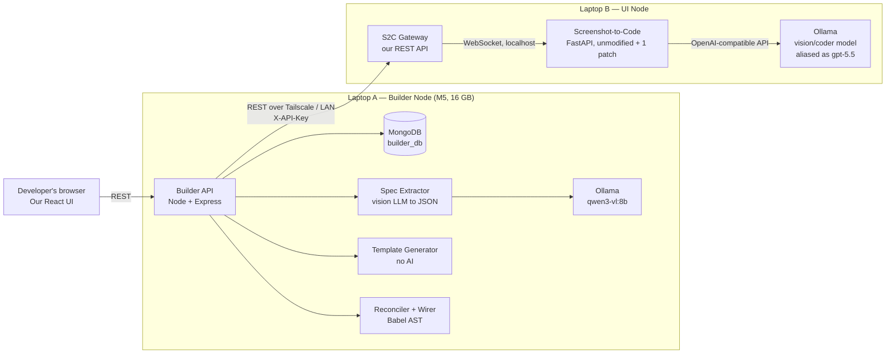
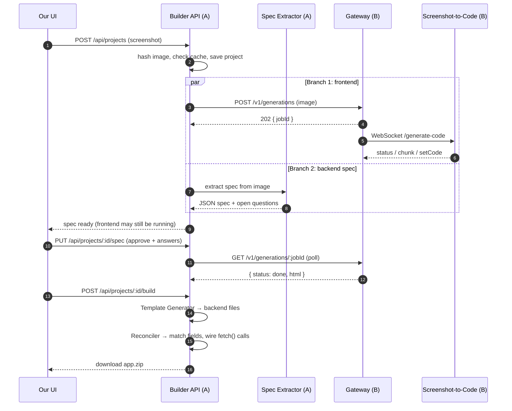

# Architecture: Two-Laptop, Local-LLM Frontend-to-Backend Builder

> **One-line summary:** Laptop B runs Screenshot-to-Code behind our own small REST API and produces the **frontend**. Laptop A runs our own pipeline, which reads the **same screenshot at the same time** and produces the **backend**. A final step joins the two into one working app. All AI runs on free local models.

**Status:** Draft for team review · **Date:** 14 Oct 2026 · **Related:** [plan.md](plan.md) (this document updates its Q3 and Q5)

---

## 1. Why this design (the four decisions)

| # | Decision | Why |
|---|---|---|
| 1 | **Split the work across two laptops by job** | Local AI models are memory-hungry. One 16 GB laptop can't run Screenshot-to-Code's model *and* our model at the same time without both slowing down. Two machines give real parallelism. |
| 2 | **Wrap Screenshot-to-Code in our own small REST "Gateway"** | Screenshot-to-Code only offers an internal WebSocket. Our Gateway turns it into a simple, stable REST API (`POST` a screenshot, `GET` the result) that anything can call. |
| 3 | **Fan-out / fan-in: both branches start from the image** | Total time becomes *the slower of the two branches*, not *the sum of both*. The developer reviews the backend plan **while** the frontend is still being generated, so no waiting time is wasted. |
| 4 | **The LLM writes a short JSON spec, never the backend code** | Local models are slow at writing long outputs and make mistakes in them. A spec of about 300 tokens is fast and easy to check. Templates turn it into backend code instantly and reliably. This is the biggest speed and quality win. |

---

## 2. The big picture



**Plain-words version:**

```
                 ┌──────────── Laptop B (UI Node) ────────────┐
screenshot ──┬──▶│ Gateway ──WS──▶ Screenshot-to-Code ──▶ Ollama│──▶ index.html (frontend)
             │   └────────────────────────────────────────────┘          │
             │   ┌──────────── Laptop A (Builder Node) ───────┐          ▼
             └──▶│ Spec Extractor ──▶ Ollama ──▶ JSON spec    │──▶ developer approves
                 │                                            │          │
                 │ Template Generator ──▶ Express + Mongo code│◀─────────┘
                 │ Reconciler/Wirer: joins frontend + backend │──▶ app.zip
                 └────────────────────────────────────────────┘
```

---

## 3. What runs where

| Machine | Runs | Owns | Does *not* do |
|---|---|---|---|
| **Laptop B: UI Node** | Screenshot-to-Code backend, **S2C Gateway** (ours), Ollama | Turning a screenshot into `index.html` | Store users or projects, generate backends |
| **Laptop A: Builder Node** | Our React UI, **Builder API** (Express), MongoDB, Ollama | Projects, jobs, the spec, backend generation, wiring, the zip | Generate UI |
| **Developer's machine** | The downloaded generated app | Running and testing it | Nothing runs on our servers (safety) |

> **Who built what?** Screenshot-to-Code (MIT license, pinned at commit `a813977`) is the only third-party code, and it stays on Laptop B. **Everything else is ours**: the Gateway, Builder API, Spec Extractor, Template Generator, Wirer and UI.

---

## 4. Request flow, step by step



1. **Upload.** The developer uploads one screenshot. We hash it with SHA-256, so the same image never pays for AI twice.
2. **Fan-out.** The Builder API starts both branches at once.
   - **Branch 1:** sends the image to the Gateway on Laptop B, which drives Screenshot-to-Code.
   - **Branch 2:** sends the image to our local vision model, which returns a **JSON spec**.
3. **Human review (hides the waiting time).** The spec usually finishes first. The developer reviews fields, rules and permissions **while** the frontend is still generating.
4. **Fan-in.** Once the frontend HTML is ready *and* the spec is approved, the Template Generator writes the backend and the Wirer connects the HTML to it.
5. **Download.** The developer gets a zip and runs it on their own machine.

---

## 5. Components

### 5.1 S2C Gateway (Laptop B, ours, about 150 lines of Node/Express)

The Gateway exists because Screenshot-to-Code has **no REST API**. It has one internal WebSocket, `/generate-code`, which streams `status`, `chunk`, `setCode`, `variantComplete` and `error` messages. The Gateway hides that behind a simple contract:

| Method | Path | Does |
|---|---|---|
| `POST` | `/v1/generations` | Upload an image; returns `202 { jobId }` |
| `GET` | `/v1/generations/:id` | `{ status: queued \| running \| done \| failed, progress, html?, error? }` |
| `GET` | `/v1/health` | Is Screenshot-to-Code up? Is the model loaded? |

Rules:
- **Auth:** every request needs the `X-API-Key` header. The key lives in `.env` on both laptops.
- **Concurrency of 1:** a simple in-memory queue. One local model can't usefully serve two big jobs at once.
- **Cache by image hash:** the same screenshot returns the saved HTML instantly.
- **Stable contract:** if Screenshot-to-Code changes its WebSocket messages, only the Gateway changes. Laptop A never notices. This is the **Adapter pattern**.
- **Fixed request settings:** `react_tailwind`, image generation **off**, asset extraction **off** (both are request parameters). This makes it faster and keeps it offline.

### 5.2 Builder API (Laptop A, ours, Node + Express + MongoDB)

| Method | Path | Does |
|---|---|---|
| `POST` | `/api/projects` | Upload a screenshot and start **both** branches |
| `GET` | `/api/projects/:id` | Status of each branch, plus the spec and HTML when ready |
| `PUT` | `/api/projects/:id/spec` | Developer edits or approves the spec and answers open questions |
| `POST` | `/api/projects/:id/build` | Fan-in: generate the backend and wire the frontend |
| `GET` | `/api/projects/:id/download` | Download `app.zip` |

### 5.3 Spec Extractor (Laptop A, ours, the AI part)

It sends the screenshot to the local vision model with a **JSON Schema**. Ollama's structured-output mode (`format` on `/api/chat`) forces the model to return valid JSON in exactly this shape:

```json
{
  "resource": "employee",
  "fields": [
    { "name": "fullName",   "label": "Full Name",  "type": "string", "required": true },
    { "name": "email",      "label": "Email",      "type": "email",  "required": true, "unique": true },
    { "name": "department", "label": "Department", "type": "enum",   "options": ["HR", "Engineering"] },
    { "name": "salary",     "label": "Salary",     "type": "number" }
  ],
  "actions": ["list", "create", "update", "delete", "search"],
  "openQuestions": [
    "Should delete be permanent or a soft delete?",
    "Who is allowed to delete employees?"
  ]
}
```

Why this is good AI design, not a gimmick: the model does the one thing code *can't* do (understand a picture). It gives a **small, checkable** answer, and it **asks** instead of guessing business rules.

### 5.4 Template Generator (Laptop A, ours, no AI)

The approved spec goes into fixed templates for `model.js` (Mongoose), `routes.js`, `controller.js`, `validation.js`, `server.js` and `.env.example`.

- Same spec in → same code out. It's instant, free and testable.
- Every generated line comes from a template **we wrote and can explain**.

### 5.5 Reconciler + Wirer (Laptop A, ours, mostly no AI)

1. Pull the JSX out of the `<script type="text/babel">` block in the generated `index.html`.
2. Parse it with `@babel/parser` and find table headers, inputs, buttons and **hard-coded sample arrays**.
3. **Reconcile:** match the frontend's labels to spec fields. For example, "Full Name" maps to `fullName` after normalising and fuzzy matching. Show any mismatch to the developer.
4. **Wire:** replace the hard-coded array with a `fetch('/api/employees')` call, and connect the Add, Edit and Delete buttons.
5. **Check:** parse again to make sure the JSX is still valid. Only if a pattern isn't recognised does a small local model do a narrow edit, and that edit is checked again.

---

## 6. Local-LLM strategy (free and fast)

### 6.1 Which model for which job

| Job | Where | Model (start here) | Why |
|---|---|---|---|
| Screenshot → spec JSON | Laptop A (16 GB) | **`qwen3-vl:8b`** (already installed, about 6 GB) | Strong small vision model; fits in 16 GB with room left over |
| Screenshot → HTML (Screenshot-to-Code) | Laptop B | Depends on Laptop B's memory (table below) | Writing long code is the heaviest job, so give it the bigger machine |
| Fallback narrow edits in the Wirer | Laptop A | The same `qwen3-vl:8b`, already loaded | Don't load a second model on 16 GB |

**Laptop B model by memory:**

| Laptop B memory | Suggested model | Note |
|---|---|---|
| 8–16 GB | `qwen3-vl:8b` | Works, but the HTML will be simpler than cloud quality |
| 24–32 GB | A larger vision model, such as the Gemma 4 or Qwen 3.x vision family, in 4-bit | Check that Ollama supports its **vision** part. Some newer models need llama.cpp or LM Studio for vision |
| 32 GB+ / NVIDIA GPU | The largest vision model that fits | Fastest and best quality |

> **How Screenshot-to-Code uses a local model:** it sets `OPENAI_BASE_URL=http://localhost:11434/v1` (Ollama's OpenAI-compatible endpoint). With only an OpenAI key set, it requests a model named `gpt-5.5`, so we create an Ollama alias with that name that points at the real local model. **This must be tested.** Screenshot-to-Code calls the OpenAI **Responses API** with streaming and **tool calls** (`create_file`, `edit_file`). Small local models are often weak at tool calling, and Ollama's support for streaming tool calls on `/v1/responses` isn't confirmed.

### 6.2 Speed techniques, in order of impact

| # | Technique | Why it's faster | Effort |
|---|---|---|---|
| 1 | **LLM outputs a short spec; templates write the code** | Generation time grows with output length, so about 300 tokens instead of thousands | Design choice |
| 2 | **Two branches in parallel, on two machines** | Total time is the slower branch, not the sum. No two models compete for one laptop's memory | Architecture |
| 3 | **One variant instead of four** in Screenshot-to-Code | It generates 4 versions by default. Locally that's about **4× the time** | 1-line patch (`NUM_VARIANTS = 1` in `config.py`) |
| 4 | **Structured outputs (JSON Schema)** | No broken JSON, so no retries | One request field |
| 5 | **Thinking off** (`think: false`) for spec extraction | Reasoning models spend many hidden tokens "thinking". A spec doesn't need it | One request field |
| 6 | **Keep models loaded** (`OLLAMA_KEEP_ALIVE=-1`) | Loading a 6 GB model from disk takes seconds on *every* cold request | Env variable |
| 7 | **Resize screenshots** (for example to at most 1280 px wide) | Fewer image tokens, so faster reading of the prompt | A few lines |
| 8 | **Cache by image hash** | The same screenshot costs 0 seconds the second time. It also protects the demo | A few lines |
| 9 | **4-bit quantised models** (Ollama default, GGUF Q4_K_M or MLX 4-bit) | About ¼ the memory of full precision with a small quality loss, so the model fits and runs faster | Choose the right tag |
| 10 | **Apple Silicon: newer Ollama with the MLX engine, or LM Studio/MLX** | MLX is reported faster than llama.cpp on M-series chips, especially larger models | Update Ollama, then benchmark |
| 11 | **Stream progress to the UI** | Doesn't reduce time, but the app *feels* fast | Polling or SSE |
| — | *Advanced, later:* **speculative decoding**, **MoE coder models** (for example Qwen3-Coder-30B-A3B, only about 3B "active" parameters) | Reported 1.5–3× faster generation, but MoE needs about 20 GB or more. Benchmark before adopting | Later |

**Ollama settings for both laptops:** `OLLAMA_KEEP_ALIVE=-1`, `OLLAMA_NUM_PARALLEL=1`, `OLLAMA_MAX_LOADED_MODELS=1`. Leave `OLLAMA_HOST` on localhost and never expose Ollama itself. Only the Gateway is reachable from outside.

### 6.3 Fallback for quality (still free)

If local HTML quality isn't good enough for the demo, **Screenshot-to-Code supports Gemini natively.** Put a **free-tier** `GEMINI_API_KEY` in Laptop B's `.env` and set no other key. That needs **no code changes**, and our Gateway contract stays exactly the same. Check the free-tier limits and data-use terms first: free tiers may use your inputs for training, so don't upload private client screenshots.

---

## 7. Networking and security

- **Connecting the laptops:** use **Tailscale** (free for personal use). Each laptop gets a stable private address, such as `http://laptop-b:8080`, that works across networks. College Wi-Fi often blocks laptop-to-laptop traffic, and Tailscale avoids that. On a home network, the LAN IP also works.
- **Never port-forward** Screenshot-to-Code or Ollama to the internet. Screenshot-to-Code's CORS setting allows every origin.
- **Exposed ports:**
  - Laptop B exposes only the Gateway (for example `:8080`), with an API key.
  - Screenshot-to-Code (`:7001`) and Ollama (`:11434`) stay on localhost.
- **Generated code is untrusted:** the Builder never runs it. The developer runs the zip on their own machine. A Docker sandbox comes later.
- **Secrets:** `.env` files are git-ignored; commit only `.env.example`.

---

## 8. Data (Laptop A, `builder_db`)

| Collection | Key fields |
|---|---|
| `projects` | `name`, `imageHash`, `imagePath`, `status`, `createdAt` |
| `jobs` | `projectId`, `kind: ui \| spec \| build`, `status`, `progress`, `error`, `remoteJobId` (the Gateway's id), `startedAt`, `finishedAt` |
| `specs` | `projectId`, `spec` (JSON above), `approved`, `answers` |
| `artifacts` | `projectId`, `kind: html \| zip`, `path`, `s2cCommit`, `model` |

> Our product's database (`builder_db`) is **separate** from the generated app's database (for example `employee_app`), whose connection string goes into the generated `.env`.

---

## 9. Build order (one checkpoint at a time)

| # | Checkpoint | Done when |
|---|---|---|
| 1 | **Local-model spike on Laptop B** | Screenshot-to-Code + Ollama alias + 1-variant patch produces *any* working `index.html`. **This decides whether the local-only plan holds** |
| 2 | **Spec Extractor spike on Laptop A** | `qwen3-vl:8b` turns 3 screenshots into valid spec JSON. Time each run |
| 3 | Gateway | `curl` can POST an image to Laptop B over Tailscale and GET the HTML |
| 4 | Builder API skeleton | Projects, jobs, MongoDB; both branches start in parallel |
| 5 | Template Generator | Approved spec → backend that passes CRUD tests |
| 6 | Reconciler + Wirer | Generated HTML talks to the generated backend |
| 7 | Our UI + demo | Upload → review spec → download → working CRUD app |

---

## 10. Risks

| Risk | Level | Mitigation |
|---|---|---|
| Small local models fail Screenshot-to-Code's **tool-calling agent** loop (empty or broken output) | **High** | Checkpoint 1 tests this first. Fallback: a bigger model on Laptop B, or the Gemini free tier (§6.3) |
| Ollama's `/v1/responses` doesn't handle a request field Screenshot-to-Code sends (`reasoning`, streaming tools) | Medium | Test in Checkpoint 1. If needed, put a tiny translating proxy in front of Ollama or use LM Studio's server |
| Local HTML quality is lower than cloud | Medium | Keep demo screenshots simple (one table + one form). Our backend side doesn't depend on HTML quality |
| 16 GB on Laptop A is tight | Medium | One model loaded, `qwen3-vl:8b` only. Close heavy apps while demoing |
| Spec fields don't match frontend labels | Medium | The Reconciler shows a mapping table and the developer fixes mismatches |
| Laptop B offline during the demo | Low | `/v1/health` check plus cached results for the demo screenshots |

---

## 11. Viva cheat-sheet

- **Why two laptops?** Local models are memory-bound. Splitting by job gives real parallelism, and nothing competes for one machine's memory.
- **Why a Gateway?** Screenshot-to-Code only has an internal WebSocket. The Gateway gives a stable REST contract and hides changes (Adapter pattern).
- **Why does the backend start from the image and not wait for the frontend?** Parallelism: total time is the slower branch, and the human review happens during the wait.
- **Where exactly is the AI?** Two places: understanding the screenshot into a spec (our pipeline), and generating the UI (Screenshot-to-Code). Code generation for the backend is deliberately **not** AI, so it's reliable and explainable.
- **How is it fast without paid APIs?** Small outputs, structured JSON, one variant, models kept loaded, 4-bit quantisation, caching and parallel machines.
- **How is it safe?** Only the Gateway is exposed, with an API key over a private network, and generated code never runs on our servers.

---

## 12. Open decisions

1. **Laptop B's specs** (memory, and whether it has an NVIDIA GPU) decide its model.
2. Confirm what the `gpt-5.5:latest` Ollama model on Laptop A was built from.
3. Local-only, or local with a Gemini free-tier fallback for the demo?

---

### Sources
- Screenshot-to-Code source, read directly at commit `a813977`: WebSocket `/generate-code`, `NUM_VARIANTS = 4`, `OPENAI_BASE_URL`, Responses API with tool calls, model sets.
- [Best Local Vision Models 2026 (promptquorum)](https://www.promptquorum.com/power-local-llm/local-vision-models-llava-ollama-2026) · [Vision models every GPU tier (insiderllm)](https://insiderllm.com/guides/vision-models-locally/) · [Run Vision Models Locally with Ollama 2026](https://vucense.com/dev-corner/run-vision-models-locally-ollama-2026/)
- [Ollama: streaming responses with tool calling](https://registry.ollama.ai/blog/streaming-tool) · [Agno: Ollama Responses API](https://docs.agno.com/examples/models/ollama/responses/overview)
- [MLX vs llama.cpp on Apple Silicon, M5 (yage.ai)](https://yage.ai/share/mlx-apple-silicon-en-20260331.html) · [Apple Silicon inference optimisation guide](https://blog.starmorph.com/blog/apple-silicon-llm-inference-optimization-guide) · [llama.cpp vs MLX 2026](https://www.local-llm.net/compare/llama-cpp-vs-mlx/)
