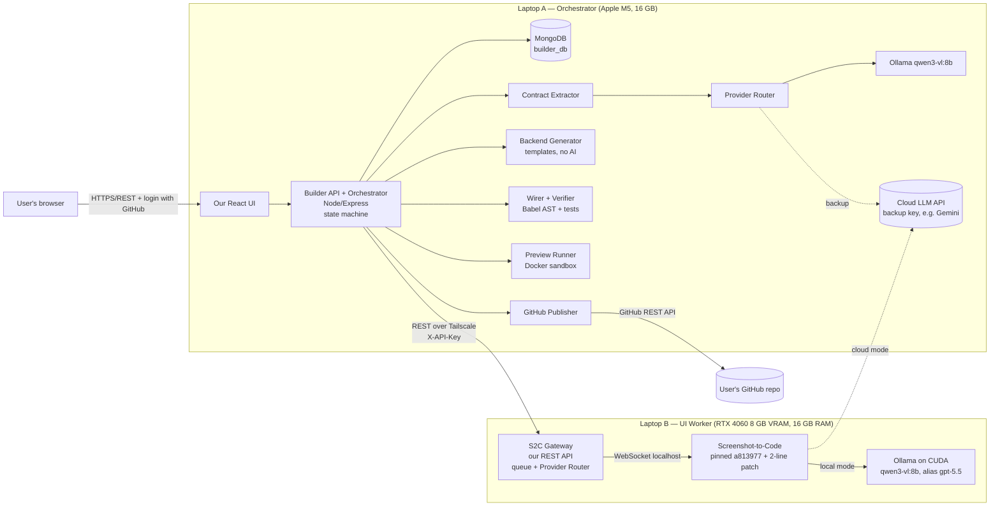
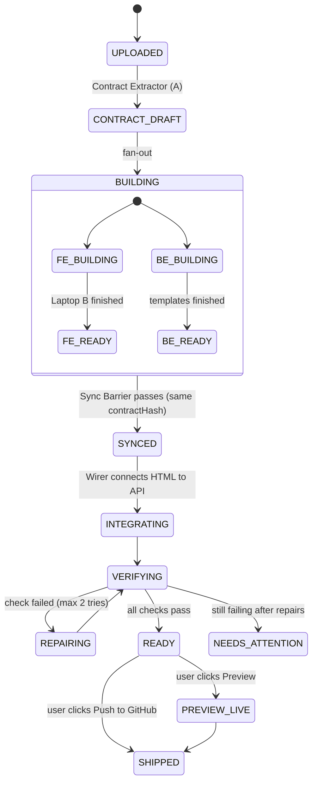

# Architecture v2: Synced Two-Laptop Builder → Working App → User's GitHub

> **One-line summary:** From one screenshot we first extract a small **Contract** (resource, fields, actions). **Both laptops build against that same Contract at the same time**: Laptop B builds the frontend (Screenshot-to-Code, GPU) and Laptop A builds the backend (our templates). A **Sync Barrier** waits until both are built for the *same* Contract version. Then we **wire, verify, preview** and **push a working app to the user's GitHub**. Local free models are the default, and a cloud API key is the automatic backup.

**Status:** Draft v2 for team review · **Date:** 14 Oct 2026 · Replaces v1 · Related: [plan.md](plan.md)

---

## 0. What's new compared with v1

| v1 | v2 (this document) | Why |
|---|---|---|
| Frontend and backend built separately, reconciled at the end | **Contract-first:** both sides build from one shared Contract | The frontend and backend agree *by design*, not by guessing afterwards |
| No real "sync" | **State machine + Contract version + Sync Barrier** | Neither side can ship with a version that doesn't match the other |
| Local models only | **Provider Router:** local first, cloud key as an automatic backup | The demo can't fail just because a local model struggled |
| Developer downloads a zip | **Verify → Live preview → Push to the user's GitHub** | The user gets a working app in their own repo |

---

## 1. The six core ideas

1. **The Contract is the single source of truth.** A small JSON document (§4) says what the app is: the resource, fields, actions and rules. Everything else is built *from* it.
2. **Laptop A is the orchestrator; Laptop B is a worker.** A owns all state (MongoDB) and decides what happens next. B only does what A asks, and **A always calls B, never the reverse**. Only B needs an open port, and A always knows the true state.
3. **Every artifact is stamped with the Contract hash.** Frontend HTML, backend code and tests each record which Contract version they were built from.
4. **The Sync Barrier.** Integration starts only when `frontend.contractHash == backend.contractHash == contract.currentHash`. This rule is what keeps the two laptops in sync.
5. **Guide the frontend, don't guess it.** Screenshot-to-Code accepts text instructions along with the image (verified in its source). We send it the Contract's exact field names plus fixed `data-field` and `data-action` markers. The frontend then has the hooks the backend expects.
6. **Ship only what passed verification.** Automated checks run before a preview or a GitHub push.

---

## 2. The big picture



---

## 3. The build lifecycle (state machine)

Every project moves through these states. A stores them in MongoDB, and the UI shows them live.



**Step by step:**

| Step | Where | What happens | Typical time* |
|---|---|---|---|
| 1. Upload | A | Hash the image (SHA-256), shrink it to at most 1280 px wide, save it | instant |
| 2. Contract draft | A | Vision model → Contract JSON (§4), forced to match a schema | seconds |
| 3a. Frontend build | **B** | Gateway → Screenshot-to-Code with **image + Contract instructions** → `index.html` | the slow part |
| 3b. Backend build | A | Templates fill in from the Contract → Express + Mongoose code + tests | instant |
| 3c. Human review | User | Reviews and edits the Contract and answers open questions **while 3a runs** | in parallel |
| 4. Sync Barrier | A | Proceed only if both artifacts match the current Contract hash | instant |
| 5. Integrate | A | Wirer replaces sample data with API calls and hooks up the action buttons | instant |
| 6. Verify | A (sandbox) | Contract check + API tests + browser smoke test (§7) | under a minute |
| 7. Preview / Ship | A | Live preview link, zip download, or **push to GitHub** | seconds |

\* Measure the real times in Checkpoints 1–2; don't promise numbers before then.

### What if the user edits the Contract mid-build?

Each edit creates **Contract version N+1** with a new hash. The Barrier then **refuses** any artifact built for version N, and the right part is rebuilt:

| Kind of edit | Backend | Frontend |
|---|---|---|
| Rename a label, change validation or rules | Regenerate (instant, free) | Wirer patches the labels. No AI call |
| Add or remove a field or action | Regenerate (instant) | Gateway job with `generationType: "update"`: Screenshot-to-Code edits the existing HTML |

---

## 4. The Contract (the "sync language" between the laptops)

```json
{
  "version": 2,
  "resource": { "name": "employee", "plural": "employees", "label": "Employees" },
  "fields": [
    { "name": "fullName",   "label": "Full Name",  "type": "string", "required": true },
    { "name": "email",      "label": "Email",      "type": "email",  "required": true, "unique": true },
    { "name": "department", "label": "Department", "type": "enum",   "options": ["HR", "Engineering", "Sales"] },
    { "name": "salary",     "label": "Salary",     "type": "number", "min": 0 }
  ],
  "actions": ["list", "create", "update", "delete", "search"],
  "rules": { "delete": "soft", "auth": "none" },
  "openQuestions": ["Who may delete employees?"],
  "ui": { "sampleConst": "SAMPLE_EMPLOYEES" }
}
```

**How the Contract keeps both sides aligned:**

| The Contract says | Laptop B (frontend) is told to | Laptop A (backend) generates |
|---|---|---|
| field `fullName` | label a column "Full Name" with `data-field="fullName"`, and a form input `name="fullName"` | Mongoose field `fullName: { type: String, required: true }` + validation |
| action `create` | add an "Add Employee" button with `data-action="create"` | `POST /api/employees` |
| action `delete` | add per-row Delete buttons with `data-action="delete"` | `DELETE /api/employees/:id` (soft delete) |
| `ui.sampleConst` | keep the sample rows in `const SAMPLE_EMPLOYEES = [...]` | the Wirer replaces exactly that constant with a `fetch` call |

Because the markers are agreed in advance, the Wirer and Verifier don't have to guess. They look for `data-field`, `data-action` and `SAMPLE_EMPLOYEES` in the code tree.

---

## 5. Laptop B: UI Worker (RTX 4060 8 GB)

### 5.1 What runs

- **Ollama (CUDA)** with `qwen3-vl:8b` (about 6.1 GB at 4-bit), aliased as `gpt-5.5`.
  - **The model must fit entirely in the 8 GB of VRAM.** If part of it spills to the CPU it becomes several times slower.
  - Check with `ollama ps`: the PROCESSOR column must say `100% GPU`.
  - If it doesn't fit, lower the context length, or switch to `qwen3-vl:4b`.
- **Screenshot-to-Code** pinned at commit `a813977`, with **a 2-line patch** (documented, not a fork):
  - `NUM_VARIANTS = 1` in `config.py` (default 4).
  - The update-mode variant count set to 1 in `routes/generate_code.py` (hard-coded 2).
  - It runs in **non-production mode**, which it needs to accept a custom model address (`openAiBaseURL`).
  - **No API keys in its `.env`.** The Gateway passes keys per request (see 5.3).
- **S2C Gateway** (ours, Node/Express): the only service other laptops can reach.

### 5.2 GPU speed settings (Ollama environment)

| Setting | Value | Why |
|---|---|---|
| `OLLAMA_FLASH_ATTENTION` | `1` | Faster attention, less VRAM |
| `OLLAMA_KV_CACHE_TYPE` | `q8_0` | Halves the memory needed for long prompts, so the model stays fully on the GPU |
| `OLLAMA_KEEP_ALIVE` | `-1` | Model stays loaded; no cold start |
| `OLLAMA_NUM_PARALLEL` | `1` | One job at a time gets the whole GPU |
| `OLLAMA_MAX_LOADED_MODELS` | `1` | No second model competing for 8 GB |
| Context length | 16k to start | Screenshot-to-Code's prompts are long; tune it while watching `ollama ps` |

### 5.3 Gateway API (Laptop B)

| Method | Path | Body / Result |
|---|---|---|
| `POST` | `/v1/generations` | `{ image, instructions, contractHash, type: create\|update, baseHtml?, mode: auto\|local\|cloud }` → `202 { jobId }` |
| `GET` | `/v1/generations/:id` | `{ status, progress, provider: local\|cloud, contractHash, html?, error? }` |
| `POST` | `/v1/generations/:id/cancel` | Stops a job that is out of date (an old Contract version) |
| `GET` | `/v1/health` | `{ s2cUp, modelLoaded, gpu: "100% GPU", queueLength, s2cCommit }` |

**How the Gateway switches between local and cloud per request.** Screenshot-to-Code reads keys and the model address from each WebSocket message (verified in its source):

- **Local mode:** sends `openAiApiKey: "ollama"` and `openAiBaseURL: "http://localhost:11434/v1"`. Screenshot-to-Code asks for "gpt-5.5", and Ollama serves our local model.
- **Cloud mode:** sends only `geminiApiKey: <backup key>`. Screenshot-to-Code picks Gemini automatically.
- **No restart is needed to switch.**

Other Gateway rules:
- `X-API-Key` on every call.
- A queue with one job at a time.
- Idempotency: the same `(imageHash, contractHash, type)` returns the same job, so retries are safe.
- Output cache by that same key.

---

## 6. Laptop A: Orchestrator (M5, 16 GB)

| Component | Job | AI? |
|---|---|---|
| **Builder API + Orchestrator** | Runs the state machine (§3), polls B every 2 s, enforces the Barrier, serves the UI | No |
| **Contract Extractor** | Image → Contract JSON using Ollama's **structured output** (`format` = JSON Schema), `think: false` | **Yes** (local `qwen3-vl:8b`, cloud backup) |
| **Provider Router** | For each AI step: local first; switch to cloud on error, timeout or invalid output; daily cloud budget cap | No |
| **Backend Generator** | Contract → Express + Mongoose code + generated tests, from templates we wrote | No |
| **Wirer** | Babel AST: replace `SAMPLE_*` with `fetch`, connect `data-action` buttons, add loading and error states | No (narrow AI fallback only) |
| **Verifier** | Runs the checks in §7 inside the sandbox | No |
| **Preview Runner** | Docker sandbox (§8) | No |
| **GitHub Publisher** | Creates the repo and pushes one commit (§9) | No |

**The Provider Router's policy, the same on both laptops:**

```
for each AI step:
  try LOCAL  (timeout: Contract 90 s, UI 8 min)
  if error / timeout / output fails the schema or markers check:
      if cloudBudgetLeft > 0: retry with CLOUD, mark artifact.provider = "cloud"
      else: NEEDS_ATTENTION
"Demo mode" switch in the UI: force CLOUD for every step (most reliable for evaluation day).
```

The UI shows a badge on each artifact, such as **"built locally on GPU"** or **"cloud backup"**. That's honest, and it's a good talking point in the viva.

---

## 7. Verify before shipping

| # | Check | How | If it fails |
|---|---|---|---|
| 1 | **Frontend matches the Contract** | Babel AST: every Contract field has `data-field`, every action has `data-action`, and `SAMPLE_*` exists | **Repair:** Gateway `update` job asking for exactly the missing markers (max 2 tries, then cloud) |
| 2 | **JSX still parses after wiring** | Re-parse with `@babel/parser` | Undo the wiring step and show the diff to the user |
| 3 | **Backend boots** | Start it in the sandbox; `GET /health` returns 200 | Template bug, so fix the template (ours) |
| 4 | **API behaves as the Contract says** | Generated tests (Jest + Supertest): create, list, update, delete, search, and a validation error | Same as above |
| 5 | **Browser smoke test** | Headless Playwright: open the page → add a record → see it in the table → edit → delete | Mark NEEDS_ATTENTION and show a screenshot |

Only a project whose checks all pass (status `READY`) can be previewed or pushed. The user can force a push, and the commit message then says that verification failed.

---

## 8. Live preview (sandbox)

- **Why it's needed now:** you want the user to *see* the working app before pushing.
- **Risk:** the backend comes from **our own templates**, so the server-side risk is low. The frontend HTML is model-generated, and it runs in the browser.
- **Where:** a Docker sandbox on Laptop A (OrbStack or Docker Desktop on macOS).

| Rule | Why |
|---|---|
| Two containers (app + mongo) on a private Docker network | The app can't reach our `builder_db` or the internet |
| Memory limit (app 512 MB, mongo 512 MB), 1 CPU, non-root user, read-only filesystem | A runaway app can't take over the laptop |
| **No secrets inside**: no GitHub token, no API keys | Nothing to steal |
| Served on a **separate port**, so a different web origin (e.g. `:7100`), not our UI's origin | Generated JS can't read our UI's cookies |
| Auto-stop after 30 min; one preview at a time | 16 GB of memory is shared with Ollama |

---

## 9. Push to the user's GitHub

### 9.1 Login and permissions
- **"Sign in with GitHub"** (a GitHub **OAuth App**) is also *our product's* login, so one feature covers user accounts too.
- **Ask for the minimum, and only when needed:**
  - At login: `read:user`.
  - When the user first clicks Publish: `public_repo` (or `repo` for private repos) plus `workflow`. `workflow` is required to push a `.github/workflows/` file.
- **Token storage:** encrypted with AES-256-GCM in MongoDB, using a key from `.env`. It never leaves Laptop A, never goes to Laptop B, and never enters a sandbox.

### 9.2 How the push works (GitHub REST API, no git commands on the server)
1. The user picks a repo name and public or private.
2. `POST /user/repos` creates a **new** repo. The MVP never overwrites an existing repo.
3. Create one *blob* per file → one *tree* → one *commit* ("Initial app generated from screenshot") → update `refs/heads/main`.
4. Show the repo link. GitHub Actions runs the included tests, so the user sees a green check.

### 9.3 What the user receives

```
employee-app/
├── README.md              how to run, the Contract, "generated by …" credits
├── contract.json          the agreed Contract (version + hash)
├── docker-compose.yml     app + mongo, one command to run
├── .env.example
├── frontend/
│   ├── index.html         generated by Screenshot-to-Code, wired by us
│   └── api.js             small fetch helper (ours, from a template)
├── backend/
│   ├── server.js          also serves frontend/, so same origin and no CORS problems
│   ├── models/employee.model.js
│   ├── routes/employee.routes.js
│   ├── controllers/employee.controller.js
│   └── validation/employee.validation.js
├── tests/
│   ├── api.test.js        generated from the Contract
│   └── smoke.spec.js      Playwright browser test
└── .github/workflows/ci.yml
```

---

## 10. Networking and security summary

| Item | Rule |
|---|---|
| Link between the laptops | **Tailscale** (free), so the private address works on any Wi-Fi, including college networks that block device-to-device traffic |
| Exposed services | Laptop A: our UI/API. Laptop B: **only the Gateway**. Screenshot-to-Code `:7001` and Ollama `:11434` stay on localhost |
| Laptop-to-laptop auth | `X-API-Key` header; key in `.env` on both laptops |
| Secrets | `.env` git-ignored. Cloud key only on the machine that needs it. GitHub tokens encrypted, only on A |
| Cloud cost | Daily cap in the Provider Router; demo screenshots cached |
| Untrusted code | Runs only in the sandbox (§8), never with secrets |

---

## 11. Our database (`builder_db` on Laptop A)

| Collection | Key fields |
|---|---|
| `users` | `githubId`, `login`, `avatarUrl`, `tokenEncrypted`, `scopes` |
| `projects` | `userId`, `name`, `imageHash`, `state` (§3), `currentContractVersion` |
| `contracts` | `projectId`, `version`, `hash`, `body` (§4), `approved`, `answers` |
| `jobs` | `projectId`, `kind: contract\|frontend\|backend\|verify\|preview\|publish`, `status`, `provider`, `contractHash`, `remoteJobId`, `error`, timestamps |
| `artifacts` | `projectId`, `kind: html\|backend\|zip`, `contractHash`, `path`, `provider`, `model` |
| `publishes` | `projectId`, `repoFullName`, `commitSha`, `verified`, `createdAt` |

> This database holds **our product's** data. The generated app has its **own** database (`employee_app`), set in its own `.env`.

---

## 12. Build plan (one checkpoint at a time)

| # | Checkpoint | Done when | Owner |
|---|---|---|---|
| 1 | **Laptop B GPU spike** | Ollama shows `100% GPU`. Screenshot-to-Code (patched) + local model + **Contract instructions** produces HTML containing the `data-field` markers. The cloud-key path is also tested | A |
| 2 | **Contract Extractor spike (A)** | 3 screenshots → valid Contract JSON; time each run; cloud backup works | B |
| 3 | **Gateway + link between the laptops** | `curl` from A over Tailscale: POST an image, poll, get the HTML; `/v1/health` works | A |
| 4 | **Orchestrator + state machine + Barrier** | Upload → both branches run → Barrier rejects a mismatched hash in a test | B |
| 5 | **Backend Generator + generated tests** | Contract → backend whose generated tests pass | C |
| 6 | **Wirer + Verifier + repair loop** | Wired HTML talks to the backend; checks 1–4 pass | C |
| 7 | **Sandbox preview + Playwright smoke** | Preview link works and auto-stops; check 5 passes | D |
| 8 | **GitHub login + Publish** | A new repo appears in the user's account, and its CI turns green | D |
| 9 | **UI + demo rehearsal** | Full run end to end, with demo mode, a cache, and a backup video | All |

**Team roles:** A = Laptop B / Gateway · B = Orchestrator / Contract · C = Generator / Wirer / Verifier · D = Sandbox / GitHub / UI.

---

## 13. Risks

| Risk | Level | Mitigation |
|---|---|---|
| Small local model doesn't follow the marker instructions, or fails Screenshot-to-Code's tool-calling loop | **High** | Checkpoint 1 tests it first; repair loop; Provider Router falls back to cloud |
| `qwen3-vl:8b` + long prompts don't fit in 8 GB of VRAM, so it slows down a lot | Medium | Q8 KV cache, flash attention, smaller context, or `qwen3-vl:4b` |
| Ollama doesn't accept a Responses API field that Screenshot-to-Code sends | Medium | Found in Checkpoint 1; the Gateway can use cloud mode while it's fixed |
| 16 GB on Laptop A: Ollama + MongoDB + Docker sandbox | Medium | One preview at a time, memory limits, unload the model before previews if needed |
| GitHub push of the workflow file rejected | Low | Request the `workflow` scope, or skip CI if the user declines |
| Laptop B offline on demo day | Low | Health indicator, cached results, demo mode (cloud), recorded backup video |
| Cloud bill | Low | Daily cap + cache + local-first |

---

## 14. Demo-day runbook

1. The day before: run all demo screenshots once, so the cache is warm.
2. Both laptops on Tailscale; check `/v1/health` → `100% GPU`.
3. Turn on **Demo mode** if the room's network or time is unreliable.
4. Flow to show: upload → Contract appears in seconds → edit one rule while the frontend builds → Barrier turns green → checks pass → live preview: add and delete an employee → **Push to GitHub** → open the repo and show the green CI.

---

## 15. Viva cheat-sheet

- **How are the laptops kept in sync?** A shared, versioned Contract; every artifact is stamped with its hash; and a Barrier that only proceeds when the hashes match. A orchestrates, B is a stateless worker, and A always initiates calls.
- **How do you know the frontend matches the backend?** The frontend is *instructed* with the Contract's field names and markers. We *verify* this by parsing the code, and *repair* it automatically if needed.
- **Where is the AI?** Reading the screenshot into a Contract, and generating the UI. The backend is template-generated on purpose, so it's predictable and explainable.
- **Why local plus a cloud backup?** Free and private by default; reliable when it matters. The Provider Router decides per step and records which one was used.
- **How is it fast?** GPU fully loaded, one variant, short structured AI outputs, parallel laptops, the human review overlapping the build, and caching.
- **How is it safe?** Minimal GitHub scopes, encrypted tokens, sandboxed previews without secrets, only the Gateway exposed, and an API key between the laptops.

---

## 16. Open decisions

1. **Laptop B's operating system** (Windows or Linux)? It affects the install steps, not the design.
2. **Which backup key?** Recommended: **Gemini**, because Screenshot-to-Code supports it natively and it has a free tier. OpenAI or Anthropic keys also work.
3. Allow **private** repos in the MVP? That needs the broader `repo` scope.

### Verified facts used here (Screenshot-to-Code @ `a813977`)
- Each WebSocket request accepts `openAiApiKey`, `anthropicApiKey`, `geminiApiKey` and `openAiBaseURL` (the last one only in non-production mode).
- Image mode uses `prompt.text` as extra instructions alongside the image.
- `NUM_VARIANTS = 4`; update mode is hard-coded to 2 variants.
- It uses the OpenAI Responses API with tool calls (`create_file`, `edit_file`).
